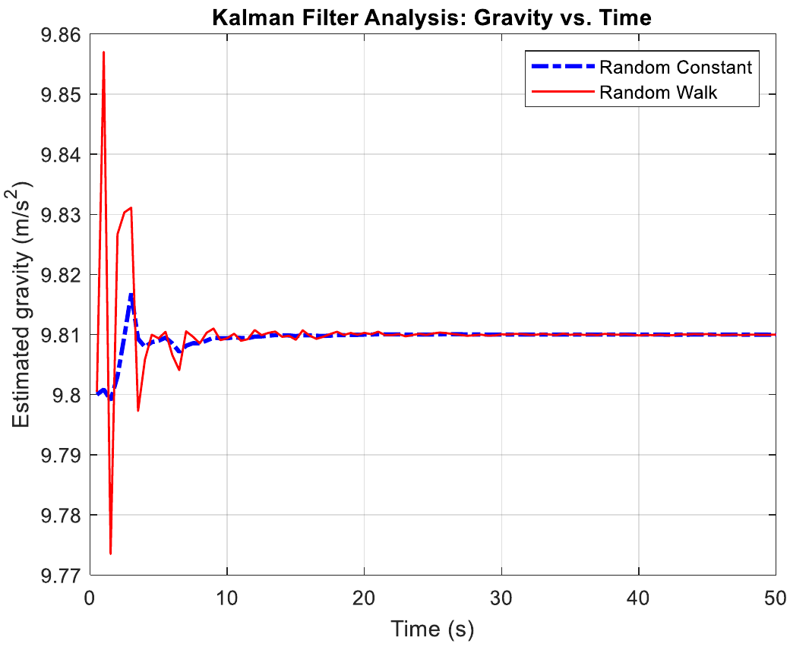

# Kalman filter: estimating gravity from falling-mass data (MATLAB)

A Kalman filter that estimates gravitational acceleration from noisy measurements of a
falling mass's vertical position. It compares two dynamic models and uses the
innovation sequence to detect outliers.



## What it does

- **Measurement model:** z = ½ g t² + v, with measurement variance 0.0025 m² (σ = 5 cm).
- **Dynamic models:**
  - *Random constant:* g does not change (Φ = 1, Q = 0).
  - *Random walk:* g can drift (Φ = 1, Q = q Δt with q = 0.02 m²/s⁵, Δt = 0.5 s).
- **Outlier detection:** at each epoch the innovation v = z − H x⁻ and its variance
  C = H P⁻ Hᵀ + R give a test statistic T = v² / C, compared with the 95% chi-squared
  threshold (3.84, one degree of freedom).

## Results (original course data)

- Both models converged to g = 9.8100 m/s².
- The random constant model converged faster and more smoothly, and its innovations
  stayed within ±0.1 m, against ±0.2 m for the random walk.
- The random constant model flagged 5 outliers (epochs 15.5, 18.0, 21.0, 25.5 and 40.0 s).
- The random walk model flagged none. Its predicted variance P⁻ cannot fall below Q,
  and because H = ½ t² grows with time, the innovation variance grows too and the test
  loses its power to detect outliers.

The takeaway: the dynamic model has to match the physics. Gravity is constant in this
experiment, so the random constant model gives the tighter estimate and the more
reliable outlier test.

## Run it

Open `kalman_gravity.m` in MATLAB (R2014b or later) and run it from the repository root.
It loads `data/sample_falling_mass.txt` and produces the plots.

The original course data set isn't included. `data/sample_falling_mass.txt` is
synthetic data with the same setup (0.5 s rate, g = 9.81 m/s², σ = 5 cm), so the
estimates and the number of outliers flagged will differ slightly from the results above.

## Layout

```
kalman_gravity.m      filter, outlier test and plots
data/                 synthetic sample data (time s, vertical position m)
docs/                 figure from the original analysis
```

Written in 2019 for a data analysis course in Geomatics Engineering at the University of Calgary.
